<p align="center">
  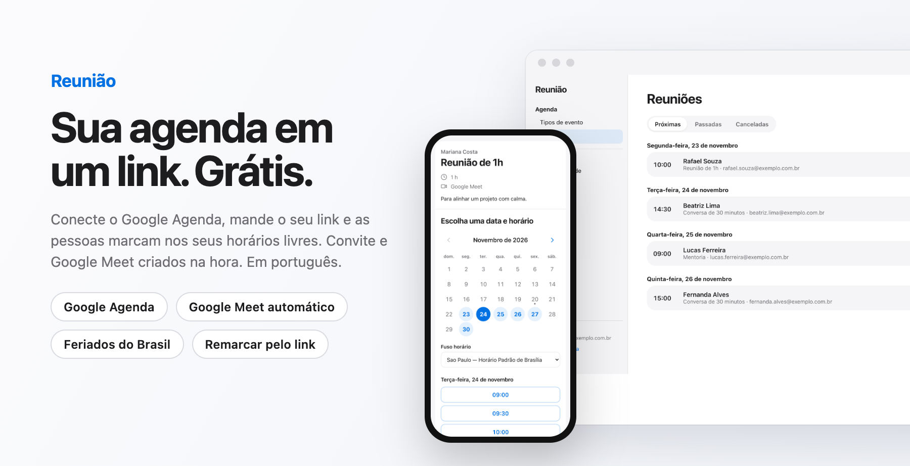
</p>

<p align="center">
  <a href="https://reuniao.app.br"><b>reuniao.app.br</b></a> ·
  <a href="https://reuniao.app.br/privacidade">Privacidade</a> ·
  <a href="https://reuniao.app.br/termos">Termos de uso</a> ·
  <a href="LICENSE">Licença</a>
</p>

O **Reunião** é um agendador de reuniões grátis e em português, uma versão enxuta do Calendly. Você entra com o Google, diz em que dias e horários atende e ganha um endereço próprio, como `reuniao.app.br/seunome`. Quem recebe o link escolhe um horário livre, e a reunião entra no seu Google Agenda com o link do Google Meet. O convidado não precisa criar conta e pode remarcar ou cancelar pelo link do e-mail.

É um produto da [DabLab](https://dablab.com.br).

## Como funciona

<p align="center">
  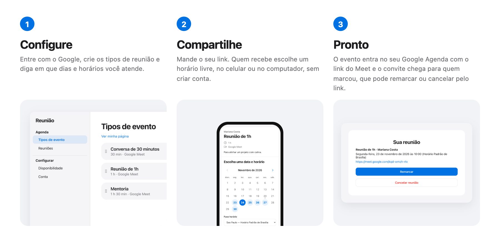
</p>

### Tipos de reunião e horários

Crie quantos tipos de reunião quiser, cada um com duração, descrição, Google Meet, antecedência mínima, até quantos dias à frente aceita reservas, intervalo antes e depois e de quanto em quanto tempo os horários começam. Um tipo pode ficar escondido da sua página e continuar funcionando pelo link direto.

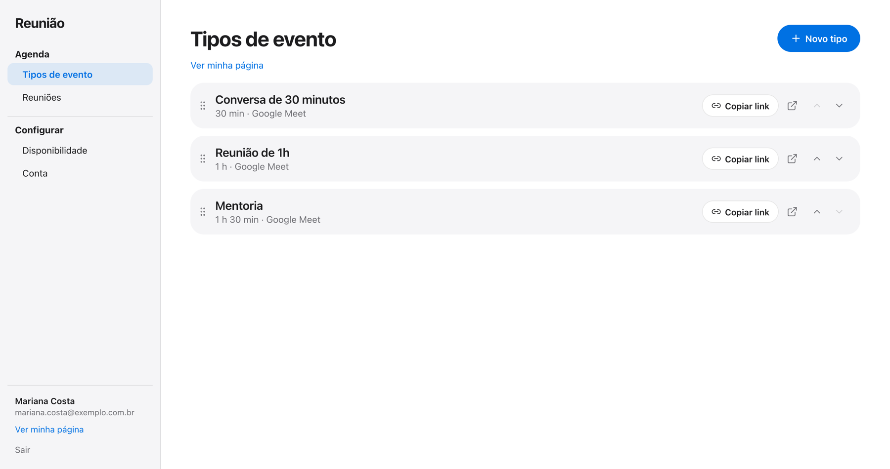

Na disponibilidade você monta a semana com várias faixas por dia, abre ou fecha datas específicas e liga ou desliga cada feriado nacional. O Reunião também consulta o seu Google Agenda e nunca oferece um horário em que você já está ocupado.

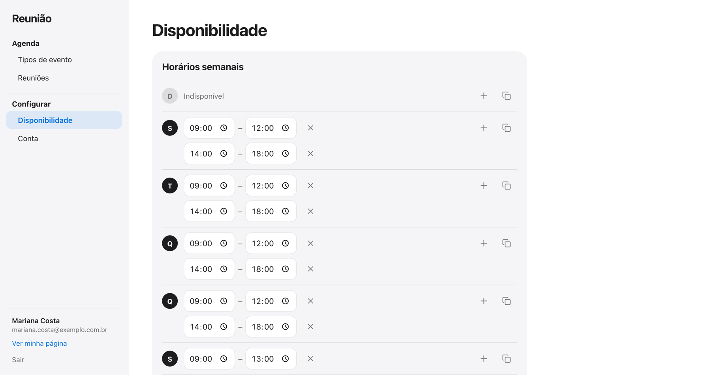

### A página que você compartilha

Quem recebe o link vê os dias com horário livre, já no fuso horário dele, escolhe um horário e informa nome e e-mail. A reunião é criada na hora no seu Google Agenda, com o Meet, e o convite chega para os dois.

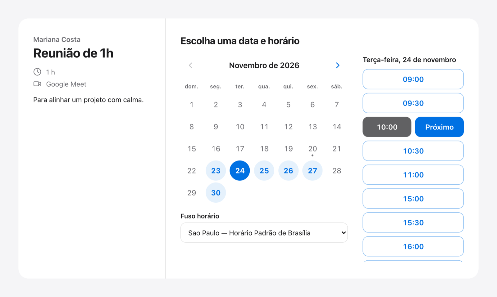

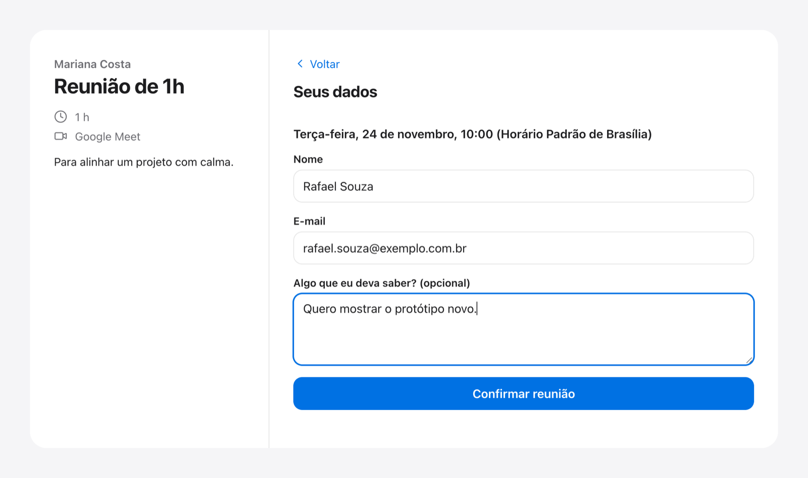

<p align="center">
  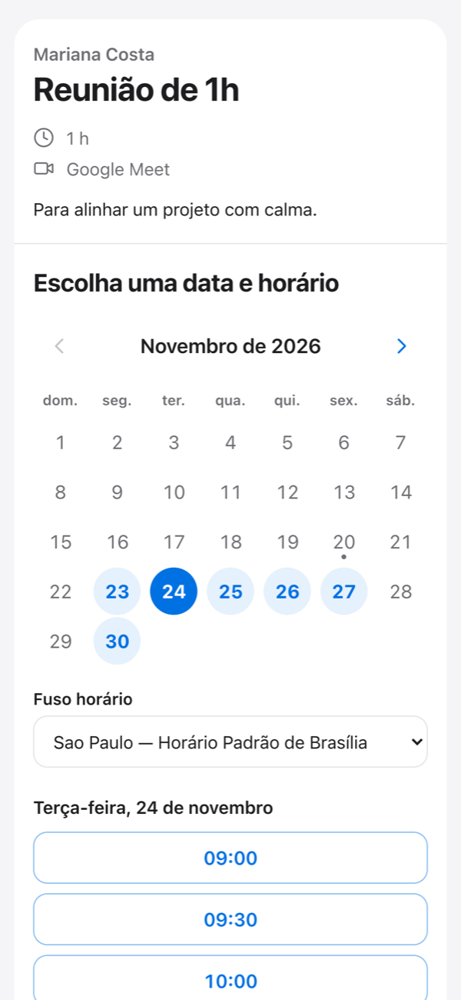
</p>

### Remarcar e cancelar sem conversa

A confirmação por e-mail traz um link só daquela reunião. Por ele o convidado vê os detalhes, remarca para outro horário livre ou cancela. O evento do Google Agenda é atualizado ou apagado junto, e você recebe um aviso por e-mail.

<p align="center">
  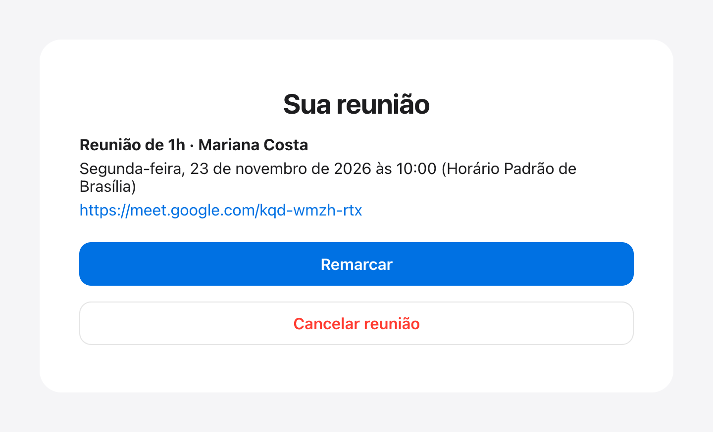
</p>

### Acompanhe as reuniões

O painel mostra as próximas reuniões, as que já passaram e as canceladas. No detalhe de cada uma estão o convidado, a observação, o link do Meet, a situação de cada e-mail (com "Reenviar" se algum falhou) e o botão para você cancelar com um motivo.

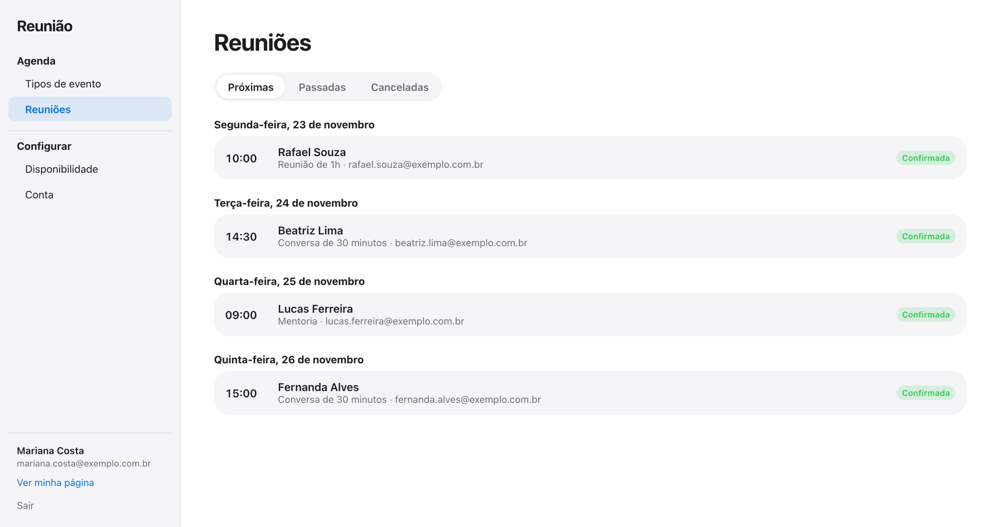

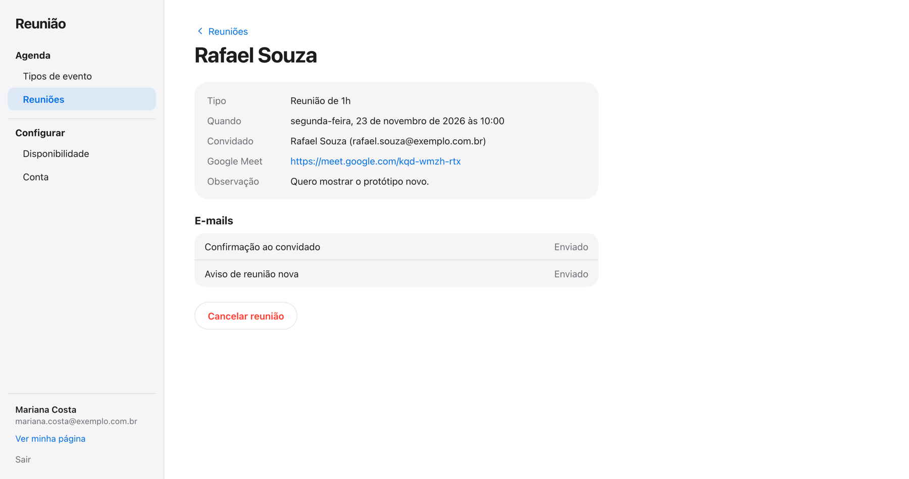

Os nomes e e-mails das figuras são fictícios.

## Arquitetura

<p align="center">
  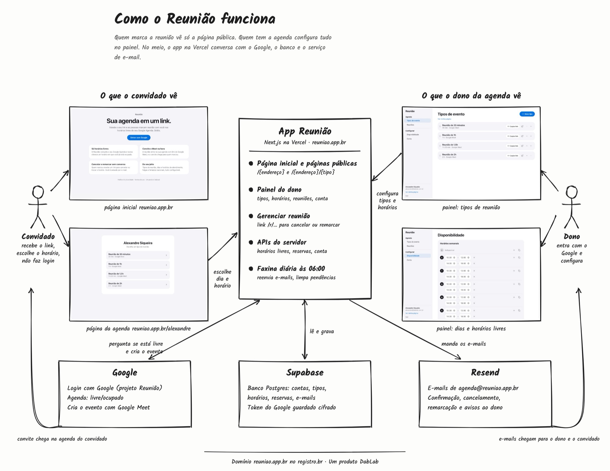
</p>

O app roda na Vercel. Ele consulta o Google para saber os horários livres e criar os eventos, guarda os dados no Supabase e manda os e-mails pelo Resend. O convidado nunca faz login; o dono entra com o Google.

## O que o Reunião é e o que não é

O Reunião cuida de uma coisa: deixar as pessoas marcarem reunião com você nos seus horários livres, sem troca de mensagens. Ele **não**:

- sincroniza agendas do Outlook ou do iCloud (a agenda é o Google);
- libera o horário se o evento for apagado direto no Google Agenda (cancele pelo Reunião);
- tem equipes, agendamento coletivo ou rodízio entre pessoas;
- cobra do convidado nem tem pagamento na reserva;
- manda lembrete antes da reunião.

## Quanto custa

Usar em [reuniao.app.br](https://reuniao.app.br) é grátis. Para proteger o serviço, há um limite de contas novas por dia, e cada convidado pode ter até 3 reuniões futuras com a mesma pessoa.

O app pede ao Google permissão para criar eventos na sua agenda. Até o Google concluir a verificação desse acesso, a tela de login mostra o aviso de app não verificado.

Para rodar a sua própria instância, o Reunião cabe nos planos gratuitos do Supabase e do Resend (este com até 100 e-mails por dia). O plano gratuito da Vercel é para uso pessoal; em uso comercial, a Vercel pede o plano Pro.

## Stack técnica

- Next.js 16 (App Router, Cache Components) com React 19 e TypeScript
- Supabase (Postgres; RLS sem políticas, acesso só pelo servidor; regras de reserva e sobreposição no banco)
- Google OAuth (login) e Google Calendar API (livre/ocupado e eventos com Meet), com o token de acesso cifrado no banco
- Resend (e-mails), Vercel (hospedagem e cron diário)
- Zod, date-fns, jose
- Vitest e pgTAP para testes

## Como foi construído

Desenvolvido com o Claude (Anthropic) a partir de uma especificação SDD: [spec.md](spec.md). Cada épico tem um plano em [plans/](plans/), e o que existe de fato está em [DOCUMENTACAO-TECNICA.md](DOCUMENTACAO-TECNICA.md).

- `npm run verify` roda typecheck, lint, testes de banco (pgTAP) e de aplicação (Vitest) e build.
- Hooks do Claude Code em `.claude/hooks/` protegem migrations versionadas, segredos e testes, e lembram de rodar os advisors do Supabase.
- Um agente verificador em `.claude/agents/` confere cada épico contra o spec antes do commit.
- Regras para o agente em [CLAUDE.md](CLAUDE.md).

| Arquivo | O que é |
|---|---|
| [`spec.md`](spec.md) | Especificação completa (fonte única de verdade) |
| [`DOCUMENTACAO-TECNICA.md`](DOCUMENTACAO-TECNICA.md) | O que está implementado de fato |
| [`CLAUDE.md`](CLAUDE.md) | Guia para sessões do Claude Code neste repositório |
| [`modelo-minha-agenda.dbml`](modelo-minha-agenda.dbml) | Modelo de dados para o dbdiagram.io |
| [`prompt-design-minha-agenda.md`](prompt-design-minha-agenda.md) | Prompt das telas para o Claude Design |
| [`plans/`](plans/) | Plano de cada épico, os bugs registrados e o andamento em `STATUS.md` |

## Licença e contribuições

O código está publicado apenas para leitura e estudo. Veja [LICENSE](LICENSE).

Issues são bem-vindas: bugs, dúvidas e sugestões. Pull requests não são aceitos. Veja [CONTRIBUTING.md](CONTRIBUTING.md).

---

# Rodar e publicar

## Rodar localmente

Pré-requisitos: Node 22, Docker e [Supabase CLI](https://supabase.com/docs/guides/cli).

```bash
npm install
supabase start                 # sobe o Postgres local nas portas 554xx
supabase migration up --local  # aplica as migrations
cp .env.example .env.local     # e preencha (ver abaixo)
npm run dev                    # http://localhost:3020
```

Se o Postgres local travar ou cancelar por timeout (`57014`), confira se outro Supabase local está ligado (`docker ps`) e pare-o: dois ao mesmo tempo sufocam o Docker.

### Variáveis de ambiente

Todas no `.env.local` em dev e nas variáveis da Vercel em produção. Só `NEXT_PUBLIC_SITE_URL` é pública; o resto é segredo de servidor.

| Variável | Para quê | Como obter |
|---|---|---|
| `NEXT_PUBLIC_SITE_URL` | Endereço do site: links dos e-mails, OAuth e checagem de origem do painel | `http://localhost:3020` em dev; `https://reuniao.app.br` em produção |
| `SUPABASE_URL`, `SUPABASE_SERVICE_ROLE_KEY` | Banco (service role; RLS sem políticas) | `supabase status -o env` em dev; painel do Supabase em produção |
| `GOOGLE_CLIENT_ID`, `GOOGLE_CLIENT_SECRET` | Login e agenda | Seção "Google Cloud" |
| `TOKEN_ENC_KEY` | Cifra o token do Google no banco (AES-256-GCM) | `openssl rand -base64 32`. Trocar invalida as conexões guardadas |
| `SESSION_SECRET` | Assina o cookie da sessão | `openssl rand -base64 32` |
| `CRON_SECRET` | Protege `/api/cron/diario` (a Vercel manda sozinha no cron) | `openssl rand -base64 32` |
| `EMAILS_PERMITIDOS`, `EMAILS_BLOQUEADOS`, `CONTAS_NOVAS_POR_DIA` | Cadastro: vazia, a lista de permitidos deixa qualquer conta Google entrar; os bloqueados nunca entram; contas novas por dia (padrão 50) | Listas separadas por vírgula |
| `RESEND_API_KEY`, `EMAIL_REMETENTE` | E-mails | Seção "Resend e DNS" |
| `VISAO_API_KEY` | Eventos de uso (opcional) | Seção "Eventos de uso na Visão de Produto" |

## Verificação

```bash
npm run verify   # typecheck, lint, pgTAP, Vitest e build
```

Saída saudável: `Result: PASS` (pgTAP), `Tests N passed` (Vitest) e a tabela de rotas do `next build`.

Outros comandos:
- `npm run db:types`: regenera `src/server/db/types.ts` a partir do banco local.
- `npm run seed:calendly -- <email> [--slug <slug>]`: grava os 5 tipos de reunião do Calendly numa conta existente (entre com o Google uma vez antes) e, com `--slug`, troca o endereço. Pode rodar de novo sem duplicar.

## Banco

Projeto Supabase **compartilhado** com outros apps da DabLab (`jeesdmfcrmhyufwzwzwt`): todo objeto do Reunião leva o prefixo `ag_`. Migrations ficam em `supabase/migrations/` e vão ao remoto pelo MCP do Supabase (`apply_migration`, mesmo SQL do arquivo), **nunca** por `supabase db push`, que tentaria sincronizar o projeto inteiro. Depois de cada migration: advisors de segurança e performance filtrados a `ag_*` e `supabase/schema.sql` regenerado.

## Google Cloud (login e agenda)

O Reunião fica num **projeto próprio "Reunião"** na conta da DabLab, para a tela de consentimento mostrar o nome certo e a verificação valer só para ele.

1. [console.cloud.google.com](https://console.cloud.google.com) → **Novo projeto** → `Reunião`.
2. **APIs e serviços → Biblioteca** → **Google Calendar API** → **Ativar**. Sem isso, o Google responde `accessNotConfigured` e nenhum horário aparece.
3. **Google Auth Platform → Branding**: nome `Reunião`; e-mail de suporte e de contato `alexandre@dablab.com.br`; página inicial `https://reuniao.app.br`; privacidade `https://reuniao.app.br/privacidade`; termos `https://reuniao.app.br/termos`; domínio autorizado `reuniao.app.br` (verificado no Search Console pela mesma conta). Depois, **Verify branding**.
4. **Público**: **Externo** → **Publicar app** ("Em produção"). Em "Teste", a conexão cai a cada 7 dias.
5. **Acesso a dados**: `openid`, `.../auth/userinfo.email`, `.../auth/userinfo.profile`, `https://www.googleapis.com/auth/calendar.freebusy` (não sensível) e `https://www.googleapis.com/auth/calendar.events.owned` (sensível: exige a verificação do Google, com justificativa e vídeo).
6. **Clientes → Criar cliente → Aplicativo da Web**, com os redirecionamentos `http://localhost:3020/api/auth/google/callback` e `https://reuniao.app.br/api/auth/google/callback`.
7. Copie o **ID do cliente** e a **Chave secreta** para `GOOGLE_CLIENT_ID` e `GOOGLE_CLIENT_SECRET`.

Até a verificação ser aprovada, o login mostra "O Google não verificou este app" (**Avançado → Acessar Reunião**) e o projeto aceita no máximo 100 usuários. Quem marca reunião nunca vê essa tela.

## Resend e DNS (e-mails)

1. [resend.com](https://resend.com) → **Domains → Add domain** → `reuniao.app.br`.
2. No DNS do domínio (registro.br), crie os registros que o Resend mostrar: TXT de DKIM (`resend._domainkey`), MX e TXT de SPF em `send` e um TXT `_dmarc` com `v=DMARC1; p=none;`.
3. Espere o domínio ficar **Verified** e crie uma **API key** com Sending access. Ponha em `RESEND_API_KEY`, e `EMAIL_REMETENTE=agenda@reuniao.app.br`.

## Deploy na Vercel e faxina diária

1. Importe o repositório na Vercel (Next.js, sem mudar comandos).
2. Copie as variáveis da tabela em **Production**, com `NEXT_PUBLIC_SITE_URL=https://reuniao.app.br`, as chaves do Supabase remoto e um `CRON_SECRET` novo.
3. **Domínio:** o principal tem que ser `reuniao.app.br` (Production) e o `www` deve redirecionar (308) para ele. Ao contrário, toda gravação do painel falha com `origem_invalida`, porque a origem precisa ser igual a `NEXT_PUBLIC_SITE_URL`. Para inverter: primeiro tire o redirect do principal, depois ponha no `www`.
4. **Cron:** o `vercel.json` chama `GET /api/cron/diario` todo dia às 09:00 UTC (06:00 em Brasília). A faxina marca como falha as reservas presas há mais de 10 minutos, reenvia os e-mails que não saíram e anonimiza as reservas com mais de 24 meses. Rodar duas vezes não reenvia nada.

```bash
curl -s -H "Authorization: Bearer $CRON_SECRET" https://reuniao.app.br/api/cron/diario
```

## Proteções do cadastro aberto

- **Suspender uma conta por abuso** (SQL no Supabase): `update ag_contas set suspensa_em = now() where slug = 'fulano';`. A página dela some (404), a sessão deixa de valer e o login é recusado. Para reativar: `set suspensa_em = null`.
- **Limite de reservas por IP** (Vercel → Firewall → **Add Rule**): `Request Path` igual a `/api/reservas` e `Method` igual a `POST`, ação **Rate Limit**, 10 requisições por 60 s por IP, resposta 429.

## Eventos de uso na Visão de Produto

Os eventos `reuniao_*` (conta criada, login, tipo criado, reunião marcada, cancelada ou remarcada, entre outros) saem do servidor para a Visão de Produto depois da resposta, com timeout de 4 s. A pessoa é identificada pelo id interno da conta, nunca pelo e-mail, e nenhum dado do Google ou do convidado é enviado. Sem `VISAO_API_KEY`, nada é enviado. A lista completa está em `plans/9.5-eventos-visao-de-produto.md`.

---

Feito pela [Dab Lab](https://www.dablab.com.br/), product studio de software e IA que constrói apps para pequenas empresas, startups e áreas dentro de grandes empresas, partindo de uma especificação (Spec-Driven Development) e com as disciplinas de engenharia de software robusta.
